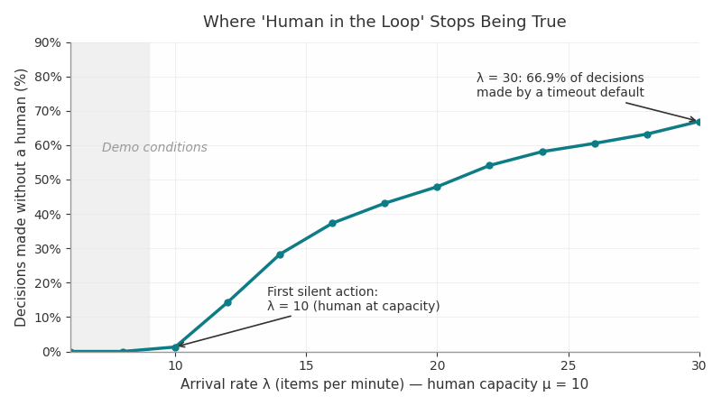
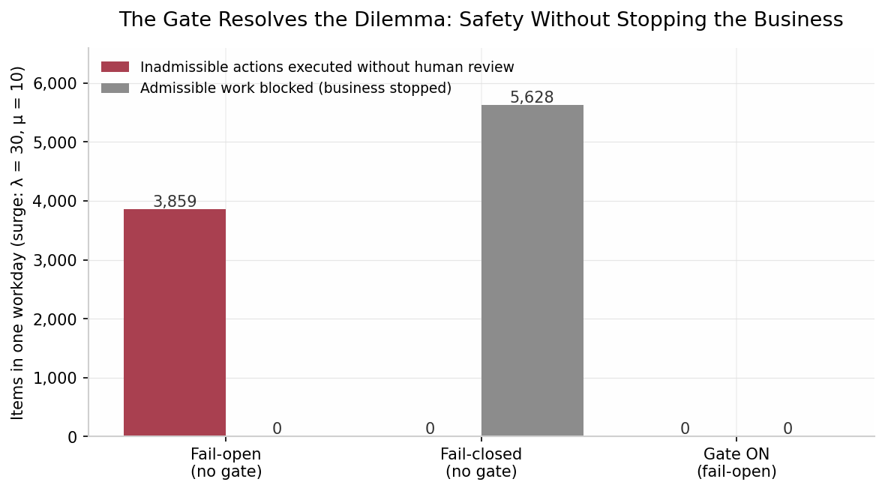

# The Timeout Decides: Where "Human in the Loop" Stops Being True

*A measured case study from BridgeCore AI*

---

A few weeks ago I published a simple diagram comparing Human in the Loop and Human on the Loop. The responses that followed were more interesting than the diagram.

One reader challenged the room: most "human in the loop" systems have never been tested under load, only under demo. The demo shows the pause screen and the person clicking approve. Nobody demos what happens when the queue backs up to 400 items and the timeout kicks in on item 12. That timeout, they wrote, is where "wait for a person" quietly turns into "acted anyway." Not a design flaw. A default nobody wrote down.

A second reader went deeper. Moving the human from the decision path to a supervisory role does not reduce uncertainty, they argued. It transfers it. Approval is not verification. The real question is what establishes the validity of an action before it executes.

Both were making engineering claims. Engineering claims can be measured. So I built the harness and measured them.

This is what I found.

## The claim under test

"Our system is human in the loop. A person approves every action before it executes."

That sentence appears in AI policies, vendor decks, and governance frameworks everywhere. It is almost always untested. The question is not whether it is well intentioned. The question is whether it survives contact with an ordinary bad day.

## The instrument

I built a small discrete-event simulator of a human approval queue. It models four things:

- **Arrival rate (λ):** how fast new decisions land in the queue.
- **Service rate (μ):** how fast the human can clear them. One human, one decision at a time.
- **Timeout:** how long an item may wait before the system stops waiting.
- **The timeout policy:** the default that fires when the deadline passes. Fail open (approve anyway), fail closed (block), defer (drop to a log), or escalate.

Every run simulates one full workday. Every number below is reproducible: the simulator is a single public Python file with a fixed random seed, available at github.com/BridgeCoreAI/hitl-under-load. You can run it, change the load, and watch the results move. Governance claims should come with evidence, and evidence should come with an instrument anyone can operate.

## Finding 1: The threshold is real, and it is exact

First, the demo. At six items per minute against a human who clears ten, the system is flawless. 2,828 decisions in a workday, the human approves all 2,828, average wait twelve seconds, the queue never deeper than sixteen items. Every demo you have ever seen looks like this, because demos are run where the claim is true.

Then we sweep the load upward.

At λ = 8, still perfect. At λ = 10, the first 64 silent actions appear. That number is not a coincidence: λ = 10 is exactly the human's capacity. The moment arrival rate reaches service rate, ordinary randomness starts pushing items past the timeout, and the default begins making decisions.

From there the curve only goes one direction. At λ = 20, 47.9% of the day's decisions are made without a human. At λ = 30, it is 66.9%. The queue peaks at 350 items, almost exactly the 400-item scenario my first commenter described.

The most telling number in the data is the one that does not move. Whether the load is 10, 20, or 30 items per minute, the human approves roughly 4,700 to 4,900 items. The human has a fixed ceiling. Everything above it belongs to the default.

**A "human in the loop" claim is not a property of the system. It is a property of the load. If you have not measured the threshold, you do not know which of your systems is past it.**

## Finding 2: Approval is not verification

The second comment raised the harder problem: even a perfectly attentive human is only inspecting proposals. Vigilance is not verification. So we added the second layer of the architecture to the harness: a deterministic admissibility gate.

Now every arriving item is either admissible or in violation of a constraint (unauthorized, malformed, out of bounds; we set 40% of traffic as violations). The gate checks each item at arrival, deterministically, in zero time, at zero human cost. Rejected items never enter the human's queue.

Same surge day (λ = 30), three configurations:

**Fail open, no gate:** 3,859 inadmissible actions executed with zero human review. Constraint violations, approved by a timeout while the human was drowning. This is the safety failure, and it is invisible in every demo.

**Fail closed, no gate:** zero inadmissible executions. But 5,628 perfectly admissible items were blocked with them. Safety purchased by stopping the business. This is the availability failure.

**Gate on:** zero inadmissible actions executed. Zero admissible work blocked. The gate rejected 5,800 violations at arrival and the human's queue shrank to genuine work only.

The dilemma the second commenter posed has a measured answer. You do not have to choose between acting unsafely and stopping the business. But you only escape that choice if admissibility is established by architecture, before execution, instead of being delegated to human vigilance during it.

## The honest limit

I want to be precise about what the gate does not fix, because this is the part that keeps the case study honest.

With the gate on, 25.7% of the day's decisions were still made by the timeout without a human. Every one of them was admissible, so no violation executed. But the human was still past capacity. The gate solves the validity problem completely and the capacity problem not at all. Capacity still requires the unglamorous work: written-down timeout defaults, escalation paths, staffing models, and load thresholds that someone measured.

Two failures, two different fixes. Validity is an architecture problem. Capacity is a design problem. A governance program that confuses them will solve one and believe it solved both.

## Verdict

The claim "a person approves every action" was tested under load and found to be conditional. It held below a measurable threshold and failed silently above it, with the failure mode determined entirely by a default nobody had written down.

The claim "supervision does not establish validity" was tested and confirmed, with one correction: validity can be established, deterministically and cheaply, but only by a layer whose entire job is admissibility, placed in the execution path where it cannot be bypassed.

Both commenters were right. About different layers. And both layers are measurable.

## What to write down on Monday morning

If your organization runs anything described as human in the loop, three questions turn this case study into an audit:

1. **What is the timeout default, and who chose it?** If nobody can answer, the system is choosing for you. The default is a governance decision. Write it down, or it will be written by an engineer's convenience.
2. **What is the measured load threshold?** At what arrival rate does your human stop being in the loop? If you do not know the number, assume some part of your operation is already past it.
3. **What establishes admissibility before execution?** If the answer is "the approver," then approval is carrying a load it was never designed to carry. The approver should see only what survived every checkable constraint.

## About this work

This case study is part of the evidence series behind the Execution Governance Model at BridgeCore AI, a runtime governance framework built on one conviction: governance is not what is defined. It is what is enforced at execution.

The simulator is public and runnable at github.com/BridgeCoreAI/hitl-under-load. If you operate a human oversight process and want to know where its threshold is, the instrument is yours.

---

*Grace M. Adjeli is an AI Governance Program Manager and the founder of BridgeCore AI. She writes about the gap between governance as documented and governance as enforced.*
